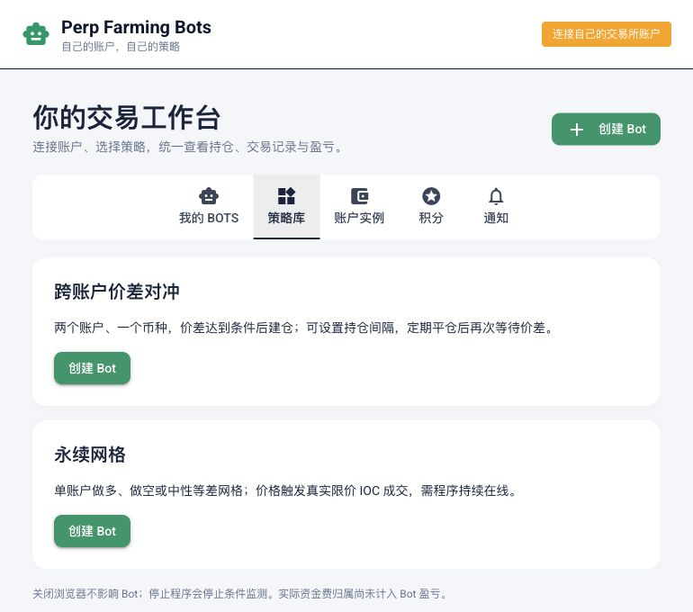

# Perp Farming Bots

[简体中文 / 新手指南](README.zh-CN.md) · [User guide](docs/guide.zh-CN.md) · [Documentation](docs/README.md)

**Want to participate in perp DEX points programs without manually opening and closing positions across several websites?**

Perp Farming Bots is a free, open-source trading tool with a Simplified Chinese interface. Connect your own accounts, choose a built-in strategy and amount, and let a bot handle repeated trading steps. See turnover, confirmed fees, trading PnL and supported points data in one place. You do not need to write strategy code.

Run it on your own computer or server. Trades use your exchange accounts, and API keys are stored locally.

## What it helps you do

| Your goal | Included tools |
| --- | --- |
| Trade with two accounts | Open a long on one account and a short on another when your spread condition is met; select each contract independently |
| Repeat a trading cycle | Close a confirmed pair after a set holding interval, wait a bounded random delay, then check the entry condition again |
| Automate buys and sells within a price range | Long, short and neutral grids that trade in increments as prices reach your grid lines |
| Understand activity and trading costs | Per-bot positions, fills, cumulative turnover, confirmed fees and trading PnL |
| Look back at points changes | Automatic Lighter Robinhood account points collection and historical charts |
| Manage several accounts | Multiple bots and multiple account instances on the same venue |

A **bot** is one independent trading task with its own account selection, settings and trade history. You can create more than one.

Points allocation and eligibility follow each venue's program rules. The tool does not promise points or airdrop returns.

## Supported platforms and invitation links

Trading integrations are available for Arcus, Lighter Core, Lighter Robinhood, Entropy and Ondo Perps. These optional invitation links are provided by the project maintainer; any referral relationship follows the platform's rules.

| Platform | Invitation link | Code |
| --- | --- | --- |
| Arcus | [Open Arcus](https://app.arcus.xyz/ref/NEAL) | `NEAL` |
| Entropy | [Open Entropy](https://entropy.io/?r=deltawillow2039) | `deltawillow2039` |
| Lighter Robinhood | [Open Lighter Robinhood](https://robinhoodchain.lighter.xyz/?referral=9264234S&source=none) | `9264234S` |

The application does not automatically register users, bind referral codes or create wallet approvals.

**Automatic points collection currently covers Lighter Robinhood only.** Arcus, Core, Entropy and Ondo Perps points queries are not integrated. Trading support and points-query support are described separately in [exchange scope](docs/exchanges.md).

## Your first bot

1. Start the application using the installation steps below.
2. Create a trading API key on your venue and connect the account in **账户实例** (Accounts). Open **API 配置指南** there, or follow the [illustrated API setup guide](docs/api-setup.zh-CN.md) for each venue's steps and field mapping.
3. Choose hedging or grid and enter your accounts, contracts and amounts.
4. Click **运行** (Run). Saving parameters alone does not start trading.
5. Review fills, turnover and PnL; use **暂停** (Pause) to retain positions or **平仓** (Close) to close that bot's allocated inventory.

Detailed account instructions and parameter explanations: [Chinese beginner guide](docs/guide.zh-CN.md).



## Install and start

Install [uv](https://docs.astral.sh/uv/getting-started/installation/) and Git. Initial setup uses the terminal; strategy configuration then happens in the browser.

```bash
git clone https://github.com/neal-zhu/perp-farming-bots.git
cd perp-farming-bots
uv sync --frozen
uv run perp-farming-bots
```

Open **http://127.0.0.1:8080**. Python 3.12 is selected by the repository configuration.

If you already use Docker, run this from the checkout:

```bash
docker compose up --build -d
```

Keep the application running. Closing the browser does not stop bots. Grids trade when prices reach a line and need the program online; they are not a full set of resting exchange orders.

The UI and API currently have no authentication. Keep the default localhost binding; use the documented SSH tunnel for a remote server. Configuration, backups and restarting: [Operations](docs/operations.md).

## Learn more and contribute

- [User guide](docs/guide.zh-CN.md): account setup, strategies, parameters, pausing and closing.
- [Hedging rules](docs/hedging.md) / [Grid rules](docs/GRID.md): exact execution behavior.
- [Exchange scope](docs/exchanges.md): account profiles, funding, fees and points limitations. Trading PnL excludes actual funding payments; missing data stays unknown. Automated tests do not certify funded acceptance across every venue.
- [Report an issue](https://github.com/neal-zhu/perp-farming-bots/issues): describe your steps and remove sensitive information from screenshots and logs.

Developers and coding agents start with [AGENTS.md](AGENTS.md), [CONTRIBUTING.md](CONTRIBUTING.md) and the [code/test map](docs/development.md). Run `make check` and `make test` for development. [Architecture](docs/architecture.md) and [API reference](docs/api.md) cover implementation details.

Application code is Apache-2.0. Dependency licenses and attributed public code reuse are recorded in [UPSTREAMS.md](UPSTREAMS.md).
