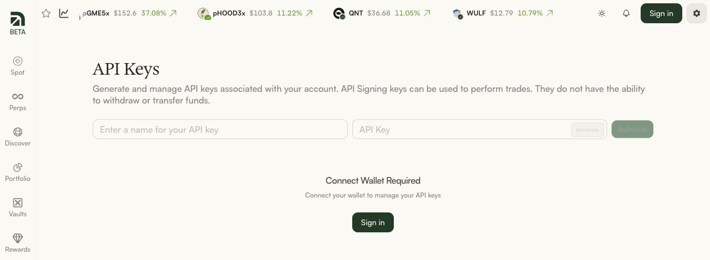
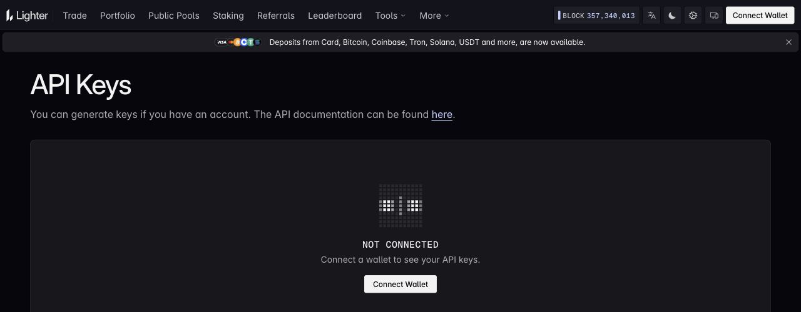
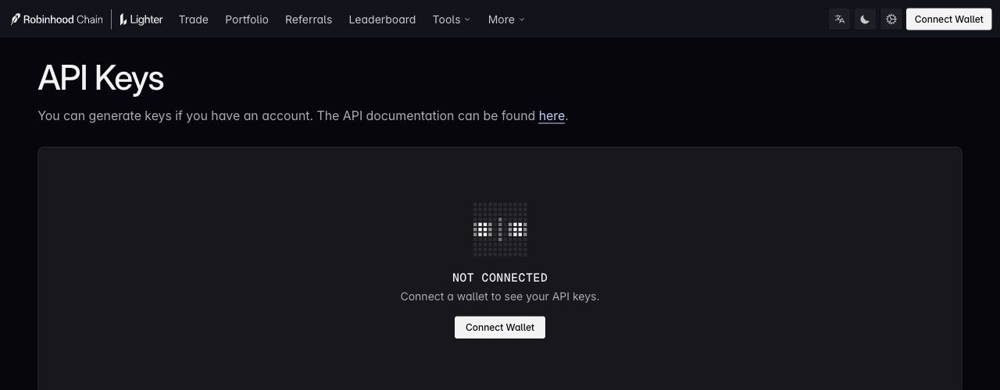
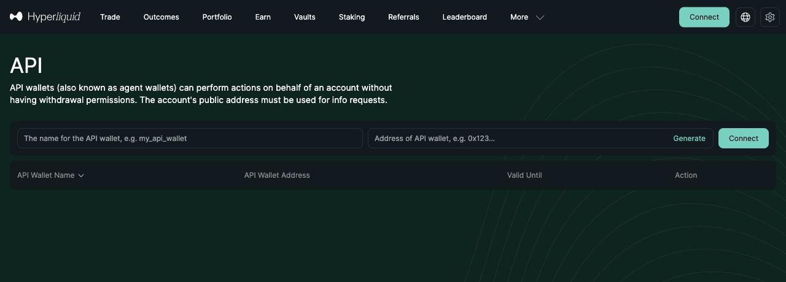
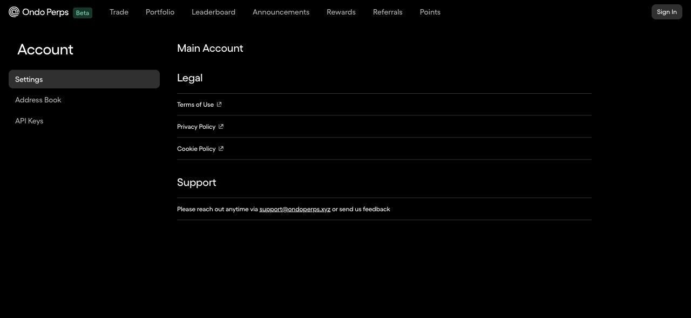

# API 配置图文指南

<!-- Generated by scripts/export_account_guide.py from account_guide.py. -->

在本工具的“账户实例”页点击“API 配置指南”，可以边看图文边配置。连接表单里的指南会直接打开当前所选交易所。指南在新标签页打开，已填写的信息会留在原表单中。

这里只填写交易 API 密钥，不填写主钱包私钥或助记词。创建与授权在交易所官网完成，本工具只验证并保存你提供的账户信息。

截图为 2026-10-16 的官方未登录页面，用于说明入口；登录后的操作按文字步骤完成。点击图片可查看大图，官网界面可能更新。

## Arcus

准备 3 项：钱包地址、子账户编号、API Signing Key。

- [打开 Arcus API Keys](https://app.arcus.xyz/api-keys)

生成密钥后还要完成官网授权；只有生成、没有授权的密钥不能连接。

1. **登录 Arcus**：打开 API Keys 页面，点击 Sign in，使用准备交给 Bot 交易的钱包登录。
2. **生成并授权密钥**：给 API 密钥起一个容易识别的名字，例如 Perp Farming Bots，点击 Generate，再按官网提示完成 Authorize 钱包授权。
3. **保存签名密钥并核对账户**：保存官网生成的 API Signing Key，记录钱包地址，并核对要交易的 Subaccount #（子账户编号）。
4. **回到本工具验证**：选择 Arcus，填写账户昵称和以下字段，再点击“验证并连接账户”。验证通过后才会保存账户。

| 本工具的字段 | 复制来源 | 填写说明 |
| --- | --- | --- |
| 钱包地址 | 登录 Arcus 的主钱包地址 | 完整的 0x 地址，不是 API 公钥。 |
| 子账户编号 | 要交易的 Subaccount # | 填写 0–9 的整数；默认账户通常为 0，以官网当前选中的账户为准。 |
| API Signing Key | 生成时保存的 Ed25519 API 签名私钥 | 填写完整签名密钥，不是 API Key 公钥，也不是登录钱包的私钥。 |

账户昵称由你自己起。填完点击“验证并连接账户”；验证通过后才可以为该账户创建 Bot。

### 提示名称不能为空？

本工具的“账户昵称”也需要填写，例如“Arcus 账户 A”；它与官网的 API 密钥名称是两个不同的名称。

### 提示密钥未注册或授权过期？

回 Arcus API Keys 检查密钥是否已 Authorize、是否过期，并确认登录钱包与填写的钱包地址一致。

### 连接后余额与官网对不上？

先核对子账户编号。不同子账户是不同的交易账户；请比较相同子账户的永续余额。

[官方 API 说明](https://docs.arcus.xyz/api-reference/authentication)

## Lighter Core

准备 3 项：Account Index、API key 编号、API 私钥。

- [打开 Lighter Core API Keys](https://app.lighter.xyz/apikeys)

Core 与 Robinhood 的密钥分别创建、分别使用。即使两个编号碰巧相同，也不能混用。

1. **连接要使用的钱包**：打开 app.lighter.xyz 的 API Keys 页面，点击 Connect Wallet。确认选中的是要交给 Bot 使用的账户。
2. **创建交易 API 密钥**：在 API Keys 创建用于交易的密钥，完成官网要求的钱包签名，并保存 API 私钥。只读 Token 和 Maker-only 密钥不适用于本工具的交易策略。
3. **记下两个不同的编号**：记录这个账户的 Account Index，以及刚才密钥对应的 API key index。它们分别代表账户和密钥，不能相互替代。
4. **回到本工具验证**：选择 Lighter Core，把下面 3 个字段填齐，再点击“验证并连接账户”。不要选择另一个 Lighter 部署。

| 本工具的字段 | 复制来源 | 填写说明 |
| --- | --- | --- |
| Account Index | 所选交易账户的 Account Index | 填写整数账户编号，不是 0x 钱包地址；使用子账户时填写该子账户自己的编号。 |
| API key 编号 | 该账户下刚创建的 API key index | 填写官网显示的密钥编号。255 表示查询全部密钥，不是一个可用于交易的密钥编号。 |
| API Signing Key | 生成密钥时保存的 API Private Key | 填写私钥，不是 API 公钥、Auth Token 或只读 Token。 |

账户昵称由你自己起。填完点击“验证并连接账户”；验证通过后才可以为该账户创建 Bot。

### 找不到 Account Index？

先在官网切换到目标账户，查看 API Keys 或账户信息中的 Account Index。若页面没有显示，可按下方官方文档的 Find Your Account Index 查询；不要把钱包地址或 API key 编号当成账户编号。

### 提示密钥不匹配或账户不存在？

核对官网是否为 app.lighter.xyz，再核对 Account Index、API key 编号和私钥是否来自同一个账户、同一次密钥创建。

### 应该手动选哪个密钥编号？

优先使用官网提供的可用编号。Core 官方文档保留 0–3；Robinhood 还保留 157，供网页或移动端使用。为 Bot 创建独立密钥，不要覆盖正在使用的密钥。

[官方 API 说明](https://apidocs.lighter.xyz/docs/get-started)

## Lighter Robinhood

准备 3 项：Account Index、API key 编号、API 私钥。

- [打开 Lighter Robinhood API Keys](https://robinhoodchain.lighter.xyz/apikeys)

Core 与 Robinhood 的密钥分别创建、分别使用。即使两个编号碰巧相同，也不能混用。

1. **连接要使用的钱包**：打开 robinhoodchain.lighter.xyz 的 API Keys 页面，点击 Connect Wallet。确认选中的是要交给 Bot 使用的账户。
2. **创建交易 API 密钥**：在 API Keys 创建用于交易的密钥，完成官网要求的钱包签名，并保存 API 私钥。只读 Token 和 Maker-only 密钥不适用于本工具的交易策略。
3. **记下两个不同的编号**：记录这个账户的 Account Index，以及刚才密钥对应的 API key index。它们分别代表账户和密钥，不能相互替代。
4. **回到本工具验证**：选择 Lighter Robinhood，把下面 3 个字段填齐，再点击“验证并连接账户”。不要选择另一个 Lighter 部署。

| 本工具的字段 | 复制来源 | 填写说明 |
| --- | --- | --- |
| Account Index | 所选交易账户的 Account Index | 填写整数账户编号，不是 0x 钱包地址；使用子账户时填写该子账户自己的编号。 |
| API key 编号 | 该账户下刚创建的 API key index | 填写官网显示的密钥编号。255 表示查询全部密钥，不是一个可用于交易的密钥编号。 |
| API Signing Key | 生成密钥时保存的 API Private Key | 填写私钥，不是 API 公钥、Auth Token 或只读 Token。 |

账户昵称由你自己起。填完点击“验证并连接账户”；验证通过后才可以为该账户创建 Bot。

### 找不到 Account Index？

先在官网切换到目标账户，查看 API Keys 或账户信息中的 Account Index。若页面没有显示，可按下方官方文档的 Find Your Account Index 查询；不要把钱包地址或 API key 编号当成账户编号。

### 提示密钥不匹配或账户不存在？

核对官网是否为 robinhoodchain.lighter.xyz，再核对 Account Index、API key 编号和私钥是否来自同一个账户、同一次密钥创建。

### 应该手动选哪个密钥编号？

优先使用官网提供的可用编号。Core 官方文档保留 0–3；Robinhood 还保留 157，供网页或移动端使用。为 Bot 创建独立密钥，不要覆盖正在使用的密钥。

[官方 API 说明](https://apidocs.rh.lighter.xyz/docs/get-started)

## Entropy

准备 2 项：主交易账户地址、已授权的 API 代理私钥。需要先完成 Entropy 的交易授权。

- [① 打开 Entropy](https://entropy.io)
- [② 打开 Hyperliquid API](https://app.hyperliquid.xyz/API)

支持标准账户和统一账户（Unified Account）；暂不支持组合保证金（Portfolio Margin）、子账户或 Vault。

1. **先在 Entropy 完成交易授权**：在 Entropy 官网连接要交易的钱包，按页面提示完成交易授权。只连接钱包、没有完成交易授权时，本工具会提示授权尚未完成。
2. **用同一主账户打开 Hyperliquid API**：Entropy 使用 Hyperliquid 的 API 代理。进入 Hyperliquid API 页面，连接与 Entropy 相同的主交易账户。
3. **创建有名称的 API 代理**：填写 API Wallet Name，例如 Perp Farming Bots，点击 Generate，保存生成的代理私钥，再按官网流程授权。不要覆盖其他程序正在使用的同名代理。
4. **把主账户地址与代理私钥带回来**：在本工具选择 Entropy。钱包地址填主交易账户地址；API Signing Key 填刚创建的代理私钥。两者对应同一个主账户后再验证。

| 本工具的字段 | 复制来源 | 填写说明 |
| --- | --- | --- |
| 钱包地址 | Entropy 与 Hyperliquid 使用的主交易账户地址 | 填写持有交易资金的主账户地址；不要复制截图中 API Wallet Address 一列的代理地址。 |
| API Signing Key | Generate 时保存的 API Wallet / Agent 私钥 | 填写代理私钥，不是 API Wallet Address，不是主钱包私钥。无需账户编号或 API key 编号。 |

账户昵称由你自己起。填完点击“验证并连接账户”；验证通过后才可以为该账户创建 Bot。

### 提示“请先在 Entropy 官网完成交易授权”？

回 Entropy 官网，用相同主账户完成其交易授权，再回本工具重新验证。Hyperliquid 的 API 代理授权与 Entropy 的交易授权都需要完成。

### 提示代理密钥未授权或过期？

检查 API 页面上的代理是否已授权、是否在有效期内，并确认创建代理时连接的主账户与填写的地址一致。

### 统一账户、组合保证金、全仓是同一个概念吗？

不是。标准/统一/组合描述账户余额的组织方式，全仓/逐仓描述合约的保证金方式。普通统一账户可以连接；组合保证金目前不能连接，不能仅通过修改合约杠杆解决。

[官方 API 说明](https://hyperliquid.gitbook.io/hyperliquid-docs/for-developers/api/nonces-and-api-wallets)

## Ondo Perps

准备 2 项：API Key ID、API Secret。选择 View & Trade 权限。

- [打开 Ondo Perps API Keys](https://app.ondoperps.xyz/account/api-keys)

如果设置 IP 白名单，允许的应是运行 Bot 的电脑或服务器的出口 IPv4，而不是浏览器所在设备的地址。

1. **登录 Ondo Perps**：在官网登录要使用的账户，进入账户页左侧的 API Keys。未登录时，链接可能先跳到账户概览。
2. **创建 View & Trade 密钥**：点击 Add New API Key，填写名称，选择 View & Trade，再点击 Create API Key。不需要 Transfer 转账权限。
3. **保存完整 ID 和 Secret**：复制带 ondoKeyId_ 前缀的 ID，以及带 ondoApiSecret_ 前缀的 Secret。Secret 创建时显示，请当场妥善保存。
4. **回到本工具验证**：选择 Ondo Perps，粘贴两项凭据并验证。账户 ID 会自动识别，不用另填钱包地址、账户编号或浏览器 Token。

| 本工具的字段 | 复制来源 | 填写说明 |
| --- | --- | --- |
| API Key ID | API Keys 列表或创建结果中的 Key ID | 保留完整 ondoKeyId_ 前缀，不是账户 ID。 |
| API Secret | 创建密钥时显示的 Secret | 保留完整 ondoApiSecret_ 前缀，不要复制成 Key ID。 |

账户昵称由你自己起。填完点击“验证并连接账户”；验证通过后才可以为该账户创建 Bot。

### 提示权限不足？

检查密钥是否为 View & Trade；只读密钥不能执行策略，无需额外开启 Transfer。

### 提示 IP 不允许或 401？

若密钥设置了 IP 白名单，核对程序运行主机的出口 IPv4 是否在名单内；同时检查密钥是否有效。

### 为什么不用填写账户编号？

程序用 Key ID 和 Secret 验证后，读取并绑定它们所属的原生账户。该接入不提供子账户切换。

[官方 API 说明](https://docs.ondoperps.xyz/api-reference/api_key_authentication)
