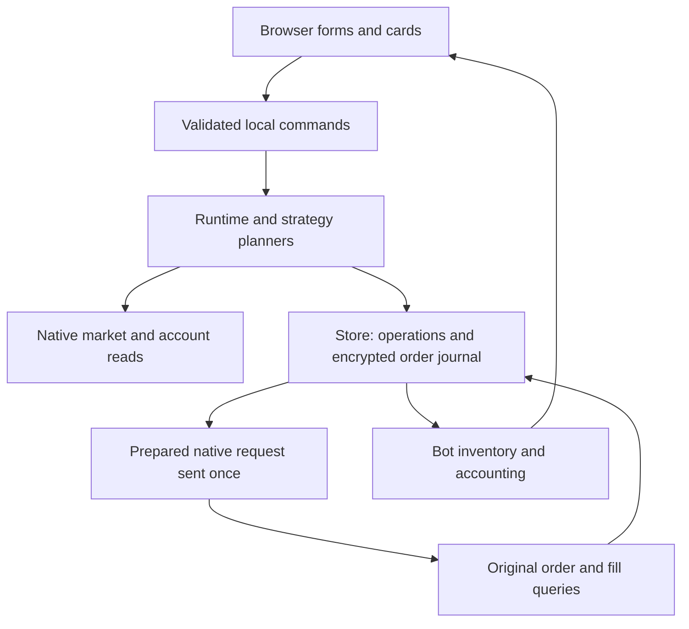

# Architecture

The application is one Python process: NiceGUI drives the browser UI, FastAPI exposes local routes, asyncio runs strategies/points/notifications, and SQLAlchemy writes SQLite transactions. There is no Node build, distributed worker, Redis, Alembic migration layer or imported full trading engine.

## Execution boundaries

The graph describes the ordering constraint, not separate services. A signed request is prepared, encrypted and stored before the adapter sends it. An acknowledgement alone does not apply inventory. Original terminal evidence must identify the native order and complete filled quantity; unknown results block further strategy writes.

## Source map

| Module | Responsibility |
| --- | --- |
| [app.py](../src/perp_farming_bots/app.py) | Environment settings, exclusive directory lock, lifecycle and server startup |
| [models.py](../src/perp_farming_bots/models.py) | Strict parameters, provider/strategy registry and native evidence models |
| [runtime.py](../src/perp_farming_bots/runtime.py) | Serialized commands, spread planning/reopening, shared execution and original-order synchronization |
| [grid.py](../src/perp_farming_bots/grid.py) | Grid preflight, target inventory, cursor progression and lifecycle |
| [store.py](../src/perp_farming_bots/store.py) | Native identities, bot ownership, transactional evidence, editability and accounting |
| [markets.py](../src/perp_farming_bots/markets.py) | Public catalogs/books/funding, precision, freshness and read-only transport retries |
| [trading.py](../src/perp_farming_bots/trading.py) | Accounts facade, Arcus and Lighter adapter contract, signing and lookup |
| [entropy.py](../src/perp_farming_bots/entropy.py) | Entropy's scoped Hyperliquid main-account and native execution adapter |
| [ondo.py](../src/perp_farming_bots/ondo.py) | Ondo HMAC account binding, native ticker rules, IOC evidence and cross-margin settings |
| [margin.py](../src/perp_farming_bots/margin.py), [native_margin.py](../src/perp_farming_bots/native_margin.py) | Native margin units and journaled setting/read-back workflow |
| [points.py](../src/perp_farming_bots/points.py), [notifications.py](../src/perp_farming_bots/notifications.py) | Independent account sampling and alert delivery |
| [ui.py](../src/perp_farming_bots/ui.py), [grid_ui.py](../src/perp_farming_bots/grid_ui.py) | Persistent pages, inline forms and user commands |
| [bot_widgets.py](../src/perp_farming_bots/bot_widgets.py), [strategy_widgets.py](../src/perp_farming_bots/strategy_widgets.py) | Bot metrics, direct controls and read-only strategy monitors |
| [points_widgets.py](../src/perp_farming_bots/points_widgets.py), [bot_styles.py](../src/perp_farming_bots/bot_styles.py) | Point history presentation and card styles |
| [api.py](../src/perp_farming_bots/api.py), [security.py](../src/perp_farming_bots/security.py) | Local HTTP routes and encrypted storage |

## Data and transactions

Money, quantity, rate and precision calculations use Decimal. Monetary SQL columns and native payloads retain decimal strings; Float columns represent timestamps. The server owns account/symbol allocations independently of exchange net positions. Native inventory must equal the sum of bot allocations before a new operation proceeds.

SQLite tables include `connections`, `bots`, `positions`, `orders`, `fills`, `operations`, `bot_cycles`, `grid_states`, `grid_actions`, `margin_changes`, `point_samples`, `alerts` and `settings`. The current schema is 9 and unsupported formats fail explicitly. There is no hidden compatibility conversion. Bot deletion retains historical trading evidence.

- `orders`: encrypted prepared request, stable intent, native identity, result and applied flag.
- `fills`: one applied aggregate per local order, providing quantity, weighted price, fee and realized price PnL.
- `positions`: confirmed quantity allocated to a bot/role, with entry price and opening fee.
- Strategy state advances transactionally only after complete applied evidence.

Connections keep encrypted private configuration outside public account responses. The instance's `encryption.key` also protects prepared requests and Telegram tokens. The same key and database must be backed up together.

## Reads, writes and recovery

`Runtime.guard` serializes trading commands and strategy actions. The Lighter SDK's native signer selection is also serialized to isolate deployment/key contexts. Read-only UI observations do not enable strategies or send orders.

Transport repeats only approved reads: GET and Entropy POST `/info`. Signed writes are single-send. Transient preflight read failures preserve the active state; continuous failures pause after five minutes. The outage timestamp is in process memory, so restart begins a new observation window. Manually paused bots do not auto-resume.

`InsufficientLiquidity` identifies a known empty book side or insufficient displayed depth for the full quantity. Grid actions and hedge entry wait only before any order journal; scheduled closes retain their schedule under the same guard. These conditions do not consume the read-outage window. Final execution quotes check full-quantity depth before preparing an order. Malformed payloads and identity mismatches remain validation failures; a crossed book is `QuoteUnavailable` rather than executable data.

Once an order journal exists, an exception must use original-order recovery rather than the unsent-operation path. Startup marks interrupted operations unknown and queries originals. A late fill can update evidence and inventory, but does not manufacture a second leg or authorize a new cycle. Margin changes similarly confirm by native read-back, with no resubmission or automatic resume.

The runtime runs independently of a browser connection. Points samples and notification delivery have their own tasks. UI polling updates existing elements; it must preserve unsaved forms, scroll and grid viewing choices.

## Strategy and authority scope

The registry contains only `spread_hedging` and `grid`. Their exact rules are in [hedging](hedging.md) and [grid](GRID.md). The shared executor does not invent stop-loss, hedge compensation, margin additions, reward claims or wallet approvals.

For accepted venue scope, fees, funding and points limits, use [exchanges.md](exchanges.md). For change seams and tests, use [development.md](development.md). Source code is authoritative when reviewing behavior; update the corresponding document in the same change.
